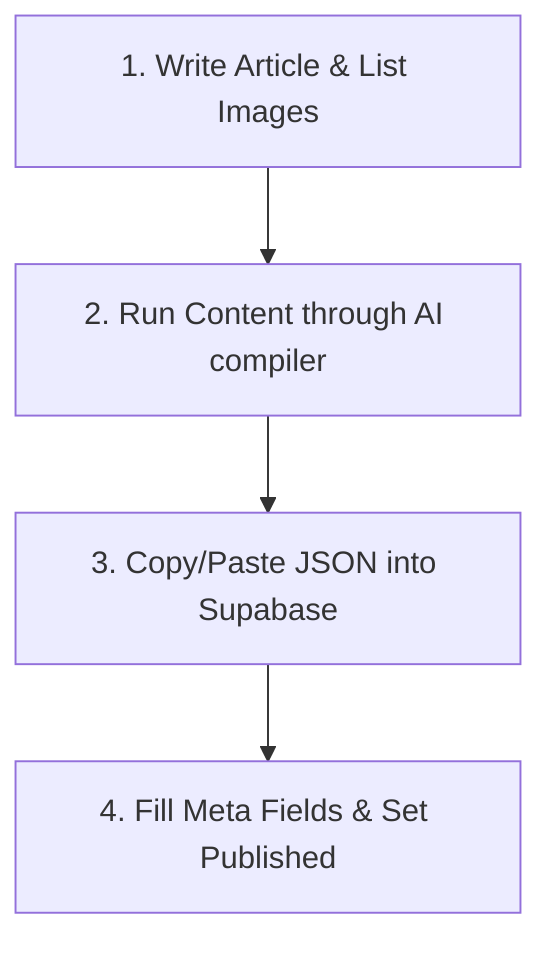

# iDecorwala Blog Owner's Guide

This guide is designed to help you prepare, compile, and publish thought leadership articles on the iDecorwala website. You do not need technical coding skills to follow these steps.

---

## Overview of the Publishing Workflow

Publishing an article follows four simple steps:



---

## Step 1: Write and Prepare Your Article

Write your article in any word processor (e.g., Microsoft Word, Google Docs). 

### How to insert images:
Since this website serves optimized, high-fidelity images, you cannot directly paste images into the text. Instead, insert image placeholders and provide their web URLs at the bottom of your text.

Use this format:

```text
=== ARTICLE ===

Here is your introductory paragraph text.

[IMAGE-1]

Here is a paragraph following the first image.

[IMAGE-2]

=== IMAGES ===
IMAGE-1: https://your-image-hosting.com/image-filename1.jpg
IMAGE-2: https://your-image-hosting.com/image-filename2.jpg
```

*Note: Ensure all image URLs are public and start with `https://`.*

---

## Step 2: Use the AI Skill to Compile Your Article

Copy your entire prepared article (including the `=== IMAGES ===` section) and paste it into the **iDecorwala Blog AI Compiler** (using the instructions defined in [BLOG_AI_SKILL.md](file:///c:/Zero-Tech/ZeroVerse/idecorwala-enterprise/BLOG_AI_SKILL.md)).

The AI will output a structured block of code (JSON). Copy this output to your clipboard.

---

## Step 3: Fill in Fields inside Supabase

Log in to your Supabase Dashboard, navigate to the `blogs` table, click **Insert Row**, and fill in the following fields:

| Field Name | Description | Example / Instructions |
| :--- | :--- | :--- |
| `title` | The main headline of the article. | *Industrializing the Interior Lifecycle* |
| `slug` | The URL address suffix (use lowercase and hyphens). | *industrializing-interior-lifecycle* |
| `excerpt` | A brief 2-3 sentence summary shown on list pages. | *An operational study examining factory production lines...* |
| `cover_image` | Public URL to the main banner image. | *https://cdn.com/cover.jpg* |
| `category` | The broad topic category (uppercase on list pages). | *Industry Trends* |
| `tags` | A list of descriptive tags. Use `featured` to show on home. | `["featured", "sustainability"]` |
| `author` | The writer's name. Defaults to iDecorwala Editorial. | *Soham Sen* |
| `published_date` | Date of publication. | *2025-05-08* |
| `reading_time` | Approximate reading time (enter the number of minutes). | *6* |
| `content` | **Paste the code (JSON) generated by the AI here.** | *Paste the JSON from Step 2.* |
| `is_published` | Check this box (set to `true`) to make it public. | `true` |

---

## Common Mistakes to Avoid

* **Broken JSON**: Ensure you copy the entire JSON code block (starting with `{` and ending with `}`) from the AI without leaving out any brackets.
* **Mismatched Image Placeholders**: Ensure the labels inside the article text (e.g. `[IMAGE-1]`) match the list at the bottom (`IMAGE-1: ...`) exactly.
* **Duplicate Slugs**: Each blog must have a unique `slug`. If two articles use the same slug, one of them will not load correctly.
* **Unpublished Drafts**: If you want to save a draft without publishing it, set `is_published` to `false`. It will not be accessible on the frontend until set to `true`.
